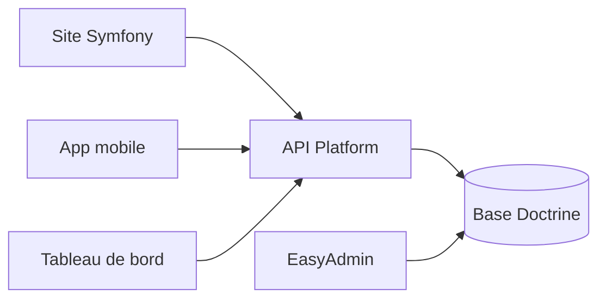

# Cinéphoria

Plateforme de **gestion de séances de cinéma** : catalogue, réservation, notation et administration des salles.

Projet réalisé pour le titre de concepteur développeur d'applications (2025). Le client mobile et le tableau de bord employé sont dans des dépôts séparés : [cinephoria-mobile](https://github.com/Meriem1403/cinephoria-mobile) et [cinephoria-desktop](https://github.com/Meriem1403/cinephoria-desktop).

<p align="center">
  
  
  
  
</p>

<p align="center">
  <strong>Dépôt :</strong> <a href="https://github.com/Meriem1403/Cinephoria">github.com/Meriem1403/Cinephoria</a>
  &nbsp;·&nbsp;
  <strong>Branche :</strong> <code>final-ecf</code>
</p>

---

## Sommaire

- [Présentation](#présentation)
- [Fonctionnalités](#fonctionnalités)
- [Stack technique](#stack-technique)
- [Architecture](#architecture)
- [Prérequis](#prérequis)
- [Installation et développement](#installation-et-développement)
- [Tests et qualité](#tests-et-qualité)
- [Déploiement](#déploiement)
- [Sécurité](#sécurité)
- [Structure du projet](#structure-du-projet)
- [Scripts disponibles](#scripts-disponibles)

---

## Présentation

Cinéphoria couvre le parcours spectateur et le back-office d'un cinéma :

- un visiteur consulte les films, choisit une séance et réserve des places ;
- un compte permet de revoir ses réservations et de noter un film ;
- un employé suit les séances, les salles et les incidents ;
- un administrateur gère le catalogue, les rôles et les cinémas.

L'API sert aussi les applications mobile et desktop.

---

## Fonctionnalités

| Module | Description |
|--------|-------------|
| **Catalogue** | Films, cinémas, salles, séances |
| **Réservation** | Choix des places, confirmation, QR code |
| **Comptes** | Inscription, connexion, réinitialisation du mot de passe |
| **Avis** | Notation des films |
| **Incidents** | Signalement côté exploitation |
| **Administration** | EasyAdmin : films, séances, salles, employés, rôles |
| **API** | API Platform consommée par le web, le mobile et le desktop |

Rôles prévus dans le modèle : visiteur, employé, administrateur.

---

## Stack technique

| Couche | Technologies |
|--------|----------------|
| Backend | PHP 8.2, Symfony 7.2 |
| API | API Platform 4, JWT |
| Admin | EasyAdmin 4 |
| Données | Doctrine ORM, migrations |
| Frontend | Twig, Stimulus, Turbo, Tailwind CSS, Webpack Encore, Chart.js |
| Qualité | PHPUnit, Qodana |
| CI | GitHub Actions (build, orchestration, déploiement) |
| Conteneurisation | Docker Compose |

---

## Architecture



---

## Prérequis

- **Docker** et Docker Compose
- **Git**
- PHP 8.2 et Composer, seulement pour un lancement hors conteneur

---

## Installation et développement

```bash
git clone https://github.com/Meriem1403/Cinephoria.git
cd Cinephoria
git checkout final-ecf
docker compose -f docker-compose.yml up --build
```

Cette pile publie l'application sur le port **10000** et Mailpit sur le port **8025**. Les identifiants de la base locale sont dans `docker-compose.yml` : ils ne servent qu'au poste de développement, et ne se réutilisent pas ailleurs.

`APP_SECRET` et `DATABASE_URL` se posent dans un fichier `.env.local`, non versionné. Un modèle de variables est dans `.deploy-now/Cinephoria/.env.local.template`.

`compose.yaml` ne démarre que PostgreSQL et Mailpit (recette Symfony). La pile applicative est `docker-compose.yml`.

La documentation de contexte est dans `Cinephoria_docs/`.

---

## Tests et qualité

```bash
# Dans le conteneur PHP, ou en local si les dépendances sont installées
php bin/phpunit
```

Les workflows `.github/workflows/` enchaînent le build, l'orchestration et le déploiement vers l'hébergeur configuré.

---

## Déploiement

| Fichier | Rôle |
|---------|------|
| `compose.yaml` / `docker-compose.yml` | Pile locale |
| `Dockerfile` | Image PHP |
| `.github/workflows/Cinephoria-build.yaml` | Build |
| `.github/workflows/Cinephoria-orchestration.yaml` | Orchestration |
| `.github/workflows/deploy-to-ionos.yaml` | Déploiement |

Les secrets de production (base, `APP_SECRET`, mailer) se posent dans l'environnement de l'hébergeur, pas dans Git.

---

## Sécurité

- `.env` ignoré. Aucun mot de passe de base dans le dépôt.
- Rôles Symfony : un visiteur ne passe pas dans EasyAdmin.
- Jetons JWT pour les clients API.
- Protection CSRF sur les formulaires Twig.

---

## Structure du projet

```
Cinephoria/
├── src/Controller/          # Réservation, films, avis, sécurité, QR
├── src/Entity/              # Movie, Showtime, Reservation, Seat, Incident…
├── templates/               # Pages Twig
├── migrations/              # Schéma Doctrine
├── tests/                   # PHPUnit
├── Cinephoria_docs/         # Dossier de contexte
└── .github/workflows/       # CI et déploiement
```

---

## Scripts disponibles

| Commande | Description |
|----------|-------------|
| `npm run dev` | Webpack Encore en mode développement |
| `npm run watch` | Recompilation des assets à chaud |
| `npm run build` | Assets de production |
| `docker compose up --build` | Pile complète |
| `php bin/phpunit` | Tests |

---

<p align="center">
  <sub>Cinéphoria — web, API, mobile et desktop. Branche de référence : <code>final-ecf</code>.</sub>
</p>
